# Robust pick-and-place with Cosmos-augmented data on a single RTX 5090

Which visual changes break a camera-only robot policy trained from ten demonstrations, and does NVIDIA Cosmos
Transfer1 augmentation help more than ordinary domain randomization (DR)? This is a simulation-only study in Isaac
Lab: four behaviour-cloning policies, the same ten human demonstrations, GR00T-Mimic expansion to 500 episodes, and
three ways of rendering them. Policies 2 to 4 are tested in the training scene and under five visual changes held out of
training, alone and all at once. Policy 1, which never succeeds, is tested in the training scene and under all five. Everything ran on one GeForce RTX 5090 with 32 GB.

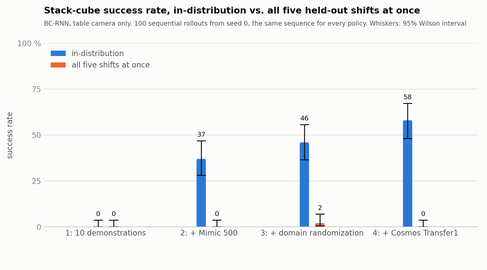

Successes out of 100 sequential rollouts from seed 0, the same rollout sequence for every policy
(`results/eval_results.md`). Light colour is a new draw from the training range, so it is a shift for policies 2 and 4
and in-distribution for policy 3. The other four shifts use ranges and assets absent from training (write-up,
Limitations). A rerun from a clean clone reproduced 21 of the 23 rows within 7 points
(`results/records/eval_results_rerun.md`):

| Condition | 1: 10 demonstrations | 2: + Mimic 500 | 3: + DR | 4: + Cosmos Transfer1 |
|---|---|---|---|---|
| training scene | 0 | 37 | 46 | **58** |
| light colour | - | 5 | 33 | **49** |
| light texture | - | 0 | **35** | 32 |
| light intensity | - | 0 | 16 | **26** |
| camera offset 5 cm | - | 20 | 9 | **28** |
| two distractor objects | - | 0 | **19** | 4 |
| all five at once | 0 | 0 | 2 | 0 |

- **Mimic expansion makes the policy work. It does not make it robust.** 0 to 37 of 100 in the training scene, then
  0 to 5 under any lighting change or two extra objects on the table.
- **Domain randomization buys lighting robustness, and Cosmos is ahead on two of the three lighting shifts and
  level on the third**, inside the intervals, plus the best training-scene rate.
- **Distractors are the Cosmos policy's blind spot**: 58 to 4, while the DR control keeps 19. Cosmos restyles
  surfaces and light but never adds objects.
- **Camera offset hurts everyone** (9 to 28). Neither augmentation moves the camera.
- **Every policy fails when all five changes land at once** (0 to 2). Individually survivable changes compound.

The analysis is in [`docs/writeup.md`](docs/writeup.md). Demo clips of every policy under every condition are in
[`docs/demos.md`](docs/demos.md). A sample:

| | training scene | new light colour | two distractor objects | all five changes |
|---|---|---|---|---|
| **2: + Mimic 500** | 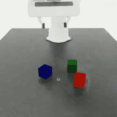 | 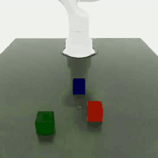 |  |  |
| **3: + DR** | 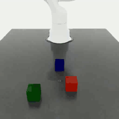 | 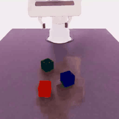 | 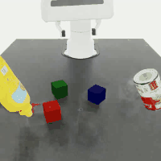 | 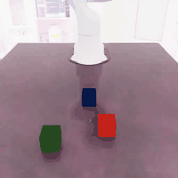 |
| **4: + Cosmos Transfer1** | 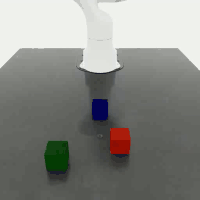 | 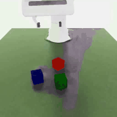 | 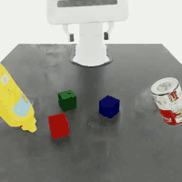 | 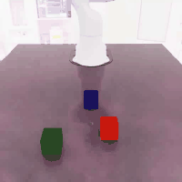 |

## The four policies

| Policy | Training images |
|---|---|
| 1 | NVIDIA's ten published demonstrations for Isaac Lab's Franka cube-stacking task |
| 2 | + 500 GR00T-Mimic episodes generated from them, fixed scene |
| 3 | + the same 500 re-rendered with Isaac Lab lighting randomization, the training half of a split of the stock HDR environments and intensity range |
| 4 | + 199 of the 500 with the table-camera frames re-synthesized by Cosmos Transfer1 7B, edge control, distilled |

All four share the network and budget: robomimic BC-RNN with a ResNet-18 encoder, 600 epochs x 500 steps. The
observation is one fixed 200x200 table camera plus end-effector pose and gripper width, and no object poses. The held-out shift (the other half of
the lighting split, a 5 cm camera offset, two YCB objects) was fixed before training. The protocol is in
[`docs/writeup.md`](docs/writeup.md).

Software: Isaac Sim 6.0.1, Isaac Lab v3.0.0-beta2.patch1, Cosmos Transfer1 at the commit Isaac Lab's guide pins. Data
generation, training and the four training-scene evaluations take about 32 hours of wall-clock with two or three jobs
sharing the GPU. The 15 single-shift evaluations take 14 hours three at a time, and the four combined ones 3.7.

## Reproduce

[`docs/tutorial.md`](docs/tutorial.md) is the one document you need: every command in order, what each step should
produce, what it costs on this machine, and a 25-row troubleshooting table. In short:

```bash
# 1. install Isaac Sim 6.0.1 and Isaac Lab v3.0.0-beta2.patch1 at ~/IsaacLab, apply the two patches, install this package
git -C ~/IsaacLab apply patches/isaaclab-franka-legacy-asset-path.patch
git -C ~/IsaacLab apply patches/isaaclab_cosmos_env_dlaa.patch
~/IsaacLab/_isaac_sim/python.sh -m pip install -e .
# 2. data: fetch NVIDIA's ten demonstrations (3 MB), then tutorial section 3 (about 14 hours of wall-clock, the Cosmos batch alone overnight)
datasets/fetch.sh
# 3. train the four policies, tutorial section 4, 6.5 h each alone
# 4. export CKPT_P1 .. CKPT_P4 (tutorial section 4), then the 23 evaluations, 100 rollouts each, and the chart
scripts/eval/eval_queue.sh results/records/eval_queue_v2_indist.txt 3
scripts/eval/eval_queue.sh results/records/eval_queue_v2_factors.txt 3
scripts/eval/eval_queue.sh results/records/eval_queue_v2_combined.txt 3
python3 scripts/eval/make_chart.py --results results/eval_results.md --out results/headline.png \
  --indist p1=p1_v2_600_ep160 p2=p2_v2_600_ep600 p3=p3_v2_600_ep600 p4=p4_v2_600_ep600 \
  --shift  p1=p1_v2_600_shift_combined p2=p2_v2_600_shift_combined p3=p3_v2_600_shift_combined p4=p4_v2_600_shift_combined
# 5. clips, three recorders at a time, into a folder on your data disk
scripts/eval/record_demos_all.sh $D/demo_clips 3
# evaluation only: download the four checkpoints and run results/records/eval_queue_hosted.txt (tutorial section 6)
```

Large files (the four checkpoints, the training sets, the Cosmos outputs, the full clips) are hosted in a public
Hugging Face dataset repository,
[layman76/cosmos-robust-pick-and-place](https://huggingface.co/datasets/layman76/cosmos-robust-pick-and-place).
The tutorial, section 6, Hosted files, says which file lets you skip which section.

## Repository layout

```
cosmos_demo/   Isaac Lab additions: project tasks, lighting split, shift events, keyboard device
scripts/       the pipeline, one folder per stage: setup/ data/ cosmos/ train/ eval/, plus diag/ the checks (replay, offline, smoke, first frames)
patches/       Isaac Lab asset path, Isaac Lab render fix, cosmos-transfer1 prompt cache
docs/          tutorial, write-up with notes before you start, clips, the pipeline diagram and its script
datasets/      fetch script for NVIDIA's ten demonstrations
results/       evaluation rows, chart, figures/, demo_gifs/, records/
```

## Before you start

Six rules for this pipeline, each with its reason in the write-up:

1. [Apply the render patch and run the render check before generating data](docs/writeup.md#apply-the-render-patch-and-run-the-render-check-before-generating-data):
   the stock Cosmos environment config renders undenoised speckle on Isaac Sim 6.0.1.
2. [Count outputs, not exit codes](docs/writeup.md#count-outputs-not-exit-codes): a Cosmos guardrail block skips a
   segment and still exits 0, and NVIDIA's own prompt template trips it.
3. [Copy the root attributes of every derived HDF5](docs/writeup.md#copy-the-root-attributes-of-every-derived-hdf5):
   without `format_version` the robot base replays rotated 180 degrees and every replay fails from step 0.
4. [Keep the stock material randomizers off](docs/writeup.md#keep-the-stock-material-randomizers-off): a runtime
   material bind corrupts the rendered geometry with Fabric on. The control randomizes lighting only.
5. [The distilled Cosmos model has no colour channel](docs/writeup.md#the-distilled-model-has-no-colour-channel):
   cubes swap colours once they touch. The write-back restores cube hue from the simulator and reports the rate.
6. [Measure augmented data on all frames](docs/writeup.md#measure-augmented-data-on-all-frames): Cosmos outputs
   match their sources on the first frame and drift afterwards.

## Licence

MIT for the code and documents in this repository. NVIDIA's software, models, assets and demonstrations keep their
own licences. See `LICENSE`.
