# Clips: every policy under every condition

Three episodes per evaluation, environment seed 0, recorded with `scripts/eval/record_demo.py`. The overview camera sits at the policy camera's pose at 512x512 and is never seen by the policy. A result card follows each episode. The episodes are chosen successes first from up to ten rollouts, the same rule for every policy. A GIF opens on a success wherever the policy managed one. The caption on each episode is its attempt number. Each GIF shows the clip's first episode, overview panel, capped at 12 s. The full clips with all three episodes and the 200x200 policy view are among the hosted files (`tutorial.md`, section 6). "Clip" lists the three shown episodes, S or F in clip order, and how many attempts succeeded. "100 rollouts" is the matching row of `results/eval_results.md`. That row is the number to trust. The clips only illustrate it.

The study reports policy 1 only in the training scene and under the combined shift, 0 of 100 in both. Its single-shift clips are included for completeness.

## Training scene

The training scene: stock table, stock dome light, three cubes, no extra objects.

| 1: 10 demonstrations | 2: + Mimic 500 | 3: + domain randomization | 4: + Cosmos Transfer1 |
|---|---|---|---|
| 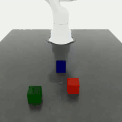 | 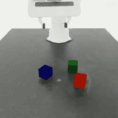 |  | 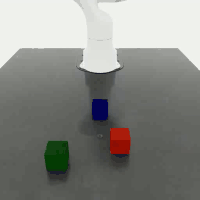 |
| clip F F F; 0/10 attempts succeeded | clip S S S; 3/6 attempts succeeded | clip S S F; 2/10 attempts succeeded | clip S S S; 3/3 attempts succeeded |
| 100 rollouts: 0/100 | 100 rollouts: 37/100 | 100 rollouts: 46/100 | 100 rollouts: 58/100 |

## Camera offset 5 cm

The table camera moved by (3, -4, 2) cm, 5.4 cm in all, orientation kept.

| 1: 10 demonstrations | 2: + Mimic 500 | 3: + domain randomization | 4: + Cosmos Transfer1 |
|---|---|---|---|
|  | 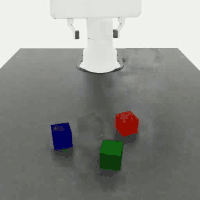 | 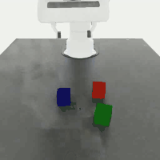 |  |
| clip F F F; 0/10 attempts succeeded | clip S F F; 1/10 attempts succeeded | clip S F F; 1/10 attempts succeeded | clip S S S; 3/4 attempts succeeded |
| 100 rollouts: not evaluated | 100 rollouts: 20/100 | 100 rollouts: 9/100 | 100 rollouts: 28/100 |

## New light colour

The dome light's colour drawn from the stock randomizer's range at reset.

| 1: 10 demonstrations | 2: + Mimic 500 | 3: + domain randomization | 4: + Cosmos Transfer1 |
|---|---|---|---|
|  | 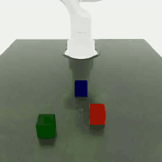 | 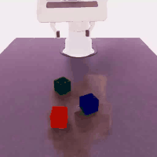 | 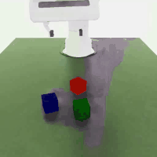 |
| clip F F F; 0/10 attempts succeeded | clip F F F; 0/10 attempts succeeded | clip S S F; 2/10 attempts succeeded | clip S S S; 3/4 attempts succeeded |
| 100 rollouts: not evaluated | 100 rollouts: 5/100 | 100 rollouts: 33/100 | 100 rollouts: 49/100 |

## New light intensity

Dome-light intensity drawn from 5000-10000 (held out) instead of 1500-5000 (training half).

| 1: 10 demonstrations | 2: + Mimic 500 | 3: + domain randomization | 4: + Cosmos Transfer1 |
|---|---|---|---|
| 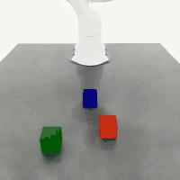 | 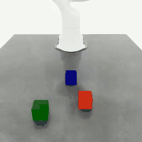 |  |  |
| clip F F F; 0/10 attempts succeeded | clip F F F; 0/10 attempts succeeded | clip F F F; 0/10 attempts succeeded | clip S S F; 2/10 attempts succeeded |
| 100 rollouts: not evaluated | 100 rollouts: 0/100 | 100 rollouts: 16/100 | 100 rollouts: 26/100 |

## New light texture

One of the five held-out HDR environment maps on the dome light.

| 1: 10 demonstrations | 2: + Mimic 500 | 3: + domain randomization | 4: + Cosmos Transfer1 |
|---|---|---|---|
| 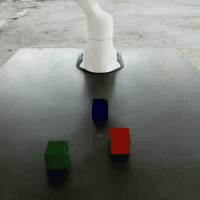 | 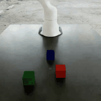 | 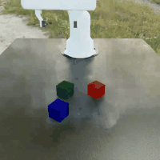 | 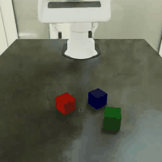 |
| clip F F F; 0/10 attempts succeeded | clip F F F; 0/10 attempts succeeded | clip S S F; 2/10 attempts succeeded | clip S S F; 2/10 attempts succeeded |
| 100 rollouts: not evaluated | 100 rollouts: 0/100 | 100 rollouts: 35/100 | 100 rollouts: 32/100 |

## Two distractor objects

A YCB tomato-soup can and mustard bottle dropped beside the cube region.

| 1: 10 demonstrations | 2: + Mimic 500 | 3: + domain randomization | 4: + Cosmos Transfer1 |
|---|---|---|---|
|  |  | 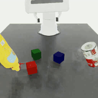 | 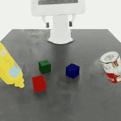 |
| clip F F F; 0/10 attempts succeeded | clip F F F; 0/10 attempts succeeded | clip S F F; 1/10 attempts succeeded | clip S F F; 1/10 attempts succeeded |
| 100 rollouts: not evaluated | 100 rollouts: 0/100 | 100 rollouts: 19/100 | 100 rollouts: 4/100 |

## All five changes at once

Every factor above applied together.

| 1: 10 demonstrations | 2: + Mimic 500 | 3: + domain randomization | 4: + Cosmos Transfer1 |
|---|---|---|---|
| 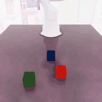 |  | 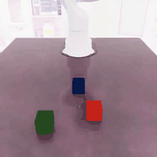 |  |
| clip F F F; 0/10 attempts succeeded | clip F F F; 0/10 attempts succeeded | clip F F F; 0/10 attempts succeeded | clip F F F; 0/10 attempts succeeded |
| 100 rollouts: 0/100 | 100 rollouts: 0/100 | 100 rollouts: 2/100 | 100 rollouts: 0/100 |
