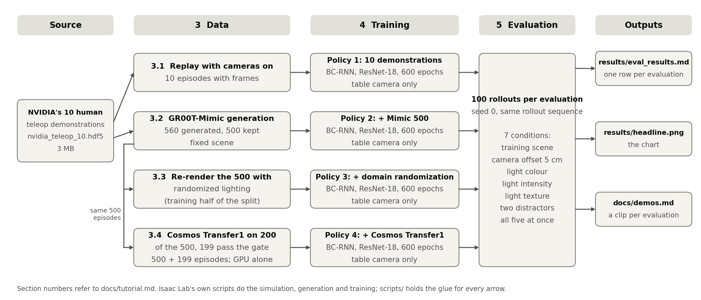

# Run the study from a fresh clone

This tutorial takes you from a clone of this repository to the finished study: four trained policies, 23
evaluations of 100 rollouts each, the headline chart and the clips. You need one workstation with a GeForce
RTX 5090 (32 GB), Isaac Sim 6.0.1 and Isaac Lab v3.0.0-beta2.patch1. Budget about 400 GB of free disk and three to
four days of GPU time. Every duration, VRAM figure and disk size below was measured on one machine, described in section 1. The
evaluation-only route skips the data generation and takes about 18 hours with three evaluations running at once.

| Section | What you get |
|---|---|
| 0 Orientation | what gets built, the pipeline figure, where things are, what each stage costs, how commands are written |
| 1 Prerequisites | the hardware and the software versions that work together |
| 2 Install | Isaac Sim, Isaac Lab, this package, the render fix, Cosmos Transfer1 |
| 3 Data | the four training sets: demonstrations, Mimic, lighting randomization, Cosmos |
| 4 Training | the four policies, one command each |
| 5 Evaluation | 100 rollouts per evaluation, the queue, the chart, the clips |
| 6 What you should get | the results table and the hosted files |
| 7 Troubleshooting | the problems you can hit, each with its fix |

Two routes:

- **Full reproduction**: sections 1 to 5 in order. About 400 GB of disk and three to four days with the plan of
  section 0.4.
- **Evaluation only**: section 1, sections 2.1 to 2.4, then the four commands of section 6, Evaluation only. About
  18 hours for all 23 evaluations with three running at once, or one hour for a single one on an idle GPU.

## 0. Orientation

### 0.1 What you will build

A Franka arm in Isaac Lab stacks three cubes. The policy sees one fixed 200x200 camera plus its own gripper pose and
width, never the cube positions, and learns by behaviour cloning (BC) with robomimic's BC-RNN for 600 epochs. The
README states the task, the policy and the test in full. The four policies share the network, the budget and the
robot motions. Only the images they train on differ:

| Policy | Trains on | What it answers |
|---|---|---|
| 1 | NVIDIA's ten human demonstrations | how far ten demonstrations get you |
| 2 | + 500 episodes generated from them by GR00T-Mimic, same scene | does more data of the same scene help |
| 3 | + the same 500 episodes re-rendered under randomized lighting | the conventional way to add visual variety |
| 4 | + 199 of the 500 episodes with the camera frames re-synthesized by Cosmos Transfer1 | the Cosmos way |

GR00T-Mimic is Isaac Lab's data generator: it takes a few annotated demonstrations and replays their segments against
new cube positions. Cosmos Transfer1 is NVIDIA's video model: it keeps the geometry of a clip and re-renders its
appearance from a text prompt.

Each evaluation is 100 sequential rollouts from one seed, the same rollout sequence for every policy. The conditions
are the training scene (labelled in-distribution in the figures), five held-out shifts, and all five at once. The
protocol is in the Setup section of [`writeup.md`](writeup.md). The 23 evaluations:

| Condition | Policy 1 | Policy 2 | Policy 3 | Policy 4 |
|---|---|---|---|---|
| training scene | yes | yes | yes | yes |
| camera moved 5 cm | - | yes | yes | yes |
| new light colour | - | yes | yes | yes |
| new light intensity | - | yes | yes | yes |
| new light texture | - | yes | yes | yes |
| two extra objects on the table | - | yes | yes | yes |
| all five at once | yes | yes | yes | yes |

### 0.2 The pipeline



Isaac Lab's own scripts do the simulation, the data generation and the training, unchanged. This repository adds two
things. The `cosmos_demo` package registers the project's tasks with Isaac Lab: the re-render task with the training
lighting, and the evaluation task with the held-out shifts. The `scripts/` folders, one per stage of the figure, hold
everything between the arrows.

Isaac Lab's stock Cosmos environment has lighting randomizers that fire only when the environment's `eval_mode` flag
is on, with `eval_type` selecting the factor. The project's tasks differ only in how they set that flag:

| Task | Lighting | Randomizers at reset | Used in |
|---|---|---|---|
| stock `...-Visuomotor-Cosmos-v0` and `...-Cosmos-Mimic-v0` | one fixed lighting | off | 3.1, 3.2, 4, training-scene evaluations |
| `CosmosDemo-...-Cosmos-DR-Mimic-v0` | the training half of the lighting split | on | 3.3 |
| `CosmosDemo-...-Cosmos-Shift-v0` | the held-out half, plus the camera offset and the distractors, one or all by `--eval_type` | on | 5 |

So policies 1, 2 and 4 train on frames rendered under one fixed lighting, and policy 4's variation comes from Cosmos
alone. Isaac Lab's replay script, which records new observations while replaying a stored file, serves twice: to
render policy 1's images (3.1) and to re-render the Mimic set under the training lighting (3.3).

### 0.3 Where things are

The README's layout block lists the folders, and every script is named in the step that runs it. Results land in
`results/`: `eval_results.md` one row per evaluation, `figures/` the evidence sheets.
To understand the study before running it, read the README, then [`writeup.md`](writeup.md). [`demos.md`](demos.md)
has a clip per evaluation.

### 0.4 What it costs on this machine

Every figure in this table, and every time or VRAM figure later in this document, was measured on the machine in
section 1. A different GPU, less RAM or a slower disk changes them, so read them as proportions between stages. "Alone"
means the GPU had nothing else to do. "Shared" means the jobs of the plan below ran together, which is slower per job
and faster overall.

| Stage | Wall-clock | Peak VRAM | Disk |
|---|---|---|---|
| 2 Install Isaac Sim and Isaac Lab | about 1 h | - | 57 GB |
| 2.5 Install Cosmos Transfer1 and checkpoints | 70 min CPU plus download | - | 80 GB checkpoints, 25 GB environment |
| 3.1 Annotate the ten demonstrations | 4 min | 6.9 GB | 0.45 GB |
| 3.2 Mimic generation and filter | 1 h 15 min | 10 GB | 30 GB, plus 42 GB of failures you can delete |
| 3.3 DR re-render and merge | 4 h 53 min shared with three trainings | 7 GB | 25 GB + 27 GB |
| 3.4 Cosmos: prepare, batch, stitch, gate, write back | 7 h 38 min GPU alone, about 1 h CPU | 27.1 GB | 60 GB |
| 4 Train one policy | 6.5 h alone, 11 to 14 h shared with two other trainings | 4.5 GB | 0.1 GB per checkpoint |
| 5 One evaluation (100 rollouts) | 55 min alone, about 2 h shared with two other evaluations | 9 to 10 GB | - |
| 5 All 23 evaluations, three at once | 17 h 47 min | 30 GB | - |
| 5 Clips, 28 policy and condition pairs, three recorders | 2 h 25 min | 7 GB each | 0.5 GB |

Two rules hold for the whole document: Isaac Sim and Cosmos never share the GPU, and at most three Isaac Sim
processes run at once (T15). Within them, this plan fits the three to four days of the opening:

| Day | Run together | Time |
|---|---|---|
| 1 | install (2.1 to 2.5), then 3.1 and 3.2 alone, then the Cosmos batch of 3.4 alone overnight | 1 h and 70 min, 1.3 h, 7.6 h |
| 2 | 3.3 beside the trainings of policies 1 and 2, then the trainings of policies 3 and 4 together | 5 h beside 11 to 14 h, then about 11 h |
| 3 | the 23 evaluations three at a time, then the clips | 18 h, then 2.4 h |

The hour totals in the README and the write-up are wall-clock spans with two or three jobs sharing the GPU. The
400 GB disk budget is an estimate from the sizes above, most of it HDF5 under `$D`. Delete as you go:
`mimic_v2_560_failed.hdf5` (42 GB) and `mimic_v2_560.hdf5` (30 GB) once the filter of 3.2 has printed `output now
500 episodes` (a top-up reads them again), and
`$C/mimic_cosmos_subset200_v2.hdf5` (10 GB) with `$C/stitched200_v2` after step 7 of 3.4.

### 0.5 How the commands are written

The shell variables below stand for the locations. Set them once per shell, with your own paths:

```bash
# conda off: isaaclab.sh would pick a conda Python over the bundled one, and an auto-activated base sets this
unset CONDA_PREFIX VIRTUAL_ENV
# this clone: git clone https://github.com/datpham99/cosmos-robust-pick-and-place.git ~/cosmos-robust-pick-and-place
REPO=~/cosmos-robust-pick-and-place
# the extracted Isaac Sim binary (section 2.1)
export ISAACSIM_DIR=~/isaacsim/isaac-sim-standalone-6.0.1-linux-x86_64
# the Isaac Lab clone (section 2.2), exported because the evaluation and prompt scripts read it
export ISAACLAB_DIR=~/IsaacLab
# a large disk for the HDF5 datasets, and Cosmos inputs and outputs under it; exported for the queue script
export D=/mnt/ssd2/cosmos_demo/datasets
export C=$D/cosmos
mkdir -p $D $C
# Isaac Sim's bundled Python, which has h5py, cv2 and torch
P=$ISAACLAB_DIR/_isaac_sim/python.sh
# the Cosmos Transfer1 clone and its checkpoints (section 2.5), read by the batch script
export COSMOS_REPO=~/cosmos-transfer1
export COSMOS_CKPT_DIR=$COSMOS_REPO/checkpoints
```

Opened a new shell during the three to four days? Run this block again first.


What the scripts assume, beyond the hardware of section 1:

- **Isaac Lab at `$ISAACLAB_DIR`.** The scripts fall back to `~/IsaacLab` when the variable is not exported.
- **Conda, any distribution.** The two Cosmos scripts find it through `conda info --base`. If `conda` is not on
  PATH, `export CONDA_BASE=<your conda root>` first (T25).
- **Packages on a clean Ubuntu 22.04.** `sudo apt install git curl unzip python3-pip libgl1-mesa-dev libegl1-mesa-dev`,
  then `python3 -m pip install matplotlib` for the chart and the pipeline figure. Every other script runs in Isaac
  Sim's Python or in the Cosmos environment.
- **An X11 session** only if you teleoperate.
- **A Hugging Face account** that has accepted the licences named in 2.5, for the Cosmos checkpoints.
- **Outputs go to `$D` and `$C`,** and the repository's `results/` holds the study's evidence. Two steps write into
  the repository on purpose, under the study's labels, so that the chart and the clips page find them. An evaluation
  appends a row to `results/eval_results.md` and, for a shift, writes `results/figures/shift_frames_<label>.png`.
  The clip driver
  rebuilds `results/demo_gifs/`, `results/figures/shift_conditions.png` and `docs/demos.md`. `git diff` shows what
  changed against the study's version.

Reading a command:

- **Where it runs.** A command that starts with `./isaaclab.sh` runs from `$ISAACLAB_DIR`, and the script after `-p` is
  a path inside that directory. Everything from this repository carries `$REPO/` in front and runs from anywhere.
- **Which Python.** `./isaaclab.sh -p <script>` and `$P <script>` both use Isaac Sim's Python. The first also sets up
  Isaac Lab and is required for anything that opens a simulator. `$P` is enough for scripts that only read or write
  HDF5 or video files, and it has robomimic after 2.2. `python3` is the system Python, enough for the chart, prompt
  and index scripts.
- **Conda off.** Every shell that runs Isaac Lab needs `conda deactivate` first, or `unset CONDA_PREFIX VIRTUAL_ENV`.
  Only the checkpoint download in 2.5 and the Cosmos batch, step 4 of 3.4, use conda, and the batch script activates
  the environment itself. After 2.5, unset `CONDA_PREFIX` again.
- **Placeholders.** Angle brackets, such as `<model.pth>`, are values you fill in.
- **The `_v2` suffix** is part of the shipped file names and labels. Keep it, so that the chart command and the clips
  page match your files.
- **You should see.** After each command, this block gives the output or files that confirm it worked.
- **Long jobs.** Wrap anything that runs for more than a few minutes in `$REPO/scripts/run_with_vram.sh <log> <command>`.
  It writes the command's output to `<log>`, samples `nvidia-smi` every 5 s and ends the log with
  `exit=... vram_peak_mib=...`. A masked Python traceback becomes exit code 99 (T5). Keep these logs: they are the
  record behind the costs of 0.4.

Names used throughout, and the seeds behind every shipped number:

| Condition | `--eval_type` | label suffix |
|---|---|---|
| training scene, labelled in-distribution in the figures | none, task `...-Visuomotor-Cosmos-v0` | `_ep<epoch>` |
| camera offset 5 cm, (3, -4, 2) cm | `camera_offset` | `_shift_camera_offset` |
| new light colour | `light_color` | `_shift_light_color` |
| new light intensity | `light_intensity` | `_shift_light_intensity` |
| new light texture | `light_texture` | `_shift_light_texture` |
| two distractor objects | `distractors` | `_shift_distractors` |
| all five at once | `all` | `_shift_combined` |

| Policy | Name in the tables | Training set | Run name | Label in the training scene |
|---|---|---|---|---|
| 1 | 10 demonstrations | `teleop_10_annotated_cosmos_v2.hdf5` | `p1_teleop10_v2_600` | `p1_v2_600_ep160` |
| 2 | + Mimic 500 | `mimic_500_v2.hdf5` | `p2_mimic500_v2_600` | `p2_v2_600_ep600` |
| 3 | + DR, domain randomization | `mimic_500_v2_dr.hdf5` | `p3_mimic500_v2_dr_600` | `p3_v2_600_ep600` |
| 4 | + Cosmos Transfer1 | `mimic_500_v2_cosmos.hdf5` | `p4_mimic500_v2_cosmos_600` | `p4_v2_600_ep600` |

| Seed | Value | Where |
|---|---|---|
| Mimic generation | 1, the task default (2 for the top-up task) | 3.2 |
| Cosmos subset draw | 0 | 3.4 step 1 |
| Cosmos prompts | 0 | 3.4 step 2 |
| Cosmos batch | 1 | 3.4 step 4 |
| training | 101, the robomimic config | 4 |
| evaluation | 0 | 5 |

Change a seed and every number downstream changes.

## 1. Prerequisites

### Hardware and OS on this machine

| Item | Value |
|---|---|
| GPU | GeForce RTX 5090, 32 GB, Blackwell, compute capability 12.0 |
| Driver | 580.159.03 (Ubuntu `nvidia-driver-580`) |
| CPU and RAM | 32 cores, 93 GB RAM |
| Disk | 57 GB for Isaac Sim, about 250 GB of HDF5 over the study, 80 GB of Cosmos checkpoints |
| OS | Ubuntu 22.04.5 LTS, kernel 6.8, X11 (needed only for GUI teleop) |

No CUDA toolkit is needed on PATH, because the PyTorch wheels bring their own runtime. NVIDIA validated Isaac Sim 6.0
on driver 580.95.05, and driver 580.159.03 works. Check yours:

```bash
nvidia-smi --query-gpu=name,driver_version,memory.total --format=csv
free -g | head -2
nproc
df -h $D
```

You should see: `NVIDIA GeForce RTX 5090, 580.x, 32607 MiB`, then your RAM, core count and the free space on the
large disk.

### Software versions (checked against NVIDIA's documentation on 2026-10-25)

| Component | Version | Why this one |
|---|---|---|
| Isaac Sim | 6.0.1 standalone binary, bundled Python 3.12 | the pip-installed 6.2 requires driver 595.58 or newer |
| Isaac Lab | tag `v3.0.0-beta2.patch1` | the only tag that pairs with Isaac Sim 6.0.1, `v3.0.0` needs Isaac Sim 6.2 |
| PyTorch | 2.10.0+cu128, torchvision 0.25.0, installed by `isaaclab.sh --install` | has `sm_120`, so the 5090 needs no custom build |
| robomimic | 0.4.0, a pip dependency of the `isaaclab_mimic` package | the separate `-i robomimic` step in the docs is stale at this tag |
| Cosmos Transfer1 | 7B edge-control distilled, repo commit `e4055e39`, the commit Isaac Lab's guide pins | the only published Transfer configuration under 32 GB (section 2.5) |

Conda has to be off in every shell that runs Isaac Lab. `isaaclab.sh` prefers
`$CONDA_PREFIX` over the bundled Python when it is set, and NVIDIA documents binary Isaac Sim plus conda as
unsupported.

## 2. Install

### 2.1 Isaac Sim

Download `isaac-sim-standalone-6.0.1-linux-x86_64.zip` from the download page of NVIDIA's Isaac Sim documentation.
The page shows the newest release, so switch the documentation version to 6.0.1 first. The archive used here has the
sha256 `348013c4d3ac398d40162566d0edfe4f3837a0eb5efa358ec87065f81aa68dd7`, 13 GB. Extract it so that `$ISAACSIM_DIR`
is its top folder, then launch it once to accept the licence and warm the shader cache:

```bash
sha256sum isaac-sim-standalone-6.0.1-linux-x86_64.zip
$ISAACSIM_DIR/isaac-sim.sh
```

You should see: the licence prompt, then an empty viewport after several minutes of shader compilation. Close it.

### 2.2 Isaac Lab

Clone the matching tag and link the Isaac Sim binary into it. Two of robomimic's dependencies need help before the
installer runs: the installer wants `cmake` on PATH or it calls `sudo apt-get`, and `egl_probe` declares a CMake
minimum that CMake 4 rejects (T1, T2):

```bash
git clone --branch v3.0.0-beta2.patch1 --depth 1 https://github.com/isaac-sim/IsaacLab.git $ISAACLAB_DIR
cd $ISAACLAB_DIR
ln -s $ISAACSIM_DIR _isaac_sim
./_isaac_sim/python.sh -m pip install cmake
CMAKE_POLICY_VERSION_MINIMUM=3.5 ./_isaac_sim/python.sh -m pip install egl_probe
PATH="$(./_isaac_sim/python.sh -c 'import cmake;print(cmake.CMAKE_BIN_DIR)'):$PATH" ./isaaclab.sh --install
```

You should see: the install complete without a traceback. On this machine: 18 min. The package versions it installs
are in `scripts/setup/isaacsim-python.freeze.txt`.

Apply the two patches. The first is needed because the Franka asset moved on NVIDIA's asset server after this tag was
cut (T4). The second fixes the stock Cosmos environment config, which renders undenoised speckle on Isaac Sim 6.0.1
(section 2.4):

```bash
git -C $ISAACLAB_DIR apply $REPO/patches/isaaclab-franka-legacy-asset-path.patch
git -C $ISAACLAB_DIR apply $REPO/patches/isaaclab_cosmos_env_dlaa.patch
```

You should see: no output. Then verify the GPU build and run a short simulation:

```bash
cd $ISAACLAB_DIR
./isaaclab.sh -p -c "import torch; print(torch.__version__, torch.version.cuda, torch.cuda.get_arch_list())"
./isaaclab.sh -p $REPO/scripts/diag/smoke_env.py --task Isaac-Stack-Cube-Franka-IK-Rel-Visuomotor-v0 \
  --enable_cameras --headless --num_envs 4 --steps 200
```

You should see: `2.10.0+cu128 12.8 [... 'sm_120' ...]`, then observation shapes with two 200x200 cameras, about 69
environment steps per second, and the process exiting by itself with no traceback. A rate under 10 means the
rendering is not on the GPU. On this machine: 55 s, 6.3 GB
VRAM. If it fails with `FileNotFoundError ... panda_instanceable.usd`, the first patch did not apply (T4).

### 2.3 This repository

Install this repository's package into Isaac Sim's Python and check that Isaac Lab can import it:

```bash
cd $REPO
$P -m pip install -e .
cd $ISAACLAB_DIR
./isaaclab.sh -p -c "import cosmos_demo.tasks"
```

You should see: no traceback. A warning about an environment already in the registry is expected. A traceback that
names `carb` or `omni` means the command ran outside Isaac Sim's Python: run it as written, from `$ISAACLAB_DIR`.
This bare import launches no app, so the import-order rule of T12 does not apply to it.

The `cosmos_demo` package registers the project tasks. Isaac Lab's scripts load it with
`--external_callback cosmos_demo.tasks.register`. Project scripts that launch Isaac Sim themselves import it after
the app starts, because importing `isaaclab_mimic` before launch crashes the app silently (T12).

| Task id | Used in | What it adds |
|---|---|---|
| `CosmosDemo-Stack-Cube-Franka-IK-Rel-Visuomotor-Cosmos-DR-Mimic-v0` | 3.3 | the training half of the lighting split, forced on at every reset |
| `CosmosDemo-Stack-Cube-Franka-IK-Rel-Visuomotor-Cosmos-Shift-v0` | 5 | the held-out half plus camera offset and distractors, one shift or all selected by `--eval_type` |
| `CosmosDemo-Stack-Cube-Franka-IK-Rel-Visuomotor-Cosmos-Mimic-Seed2-v0` | 3.2, top-up only | the stock Mimic generation task with generation seed 2 |
| `CosmosDemo-Stack-Cube-Franka-IK-Rel-v0` | optional teleop | the stock task with a keyboard device that works over a remote desktop (T6, T7) |

### 2.4 Render check

The second patch from 2.2 restores two settings of the plain visuomotor config to the stock Cosmos environment config.
DLAA antialiasing denoises the path tracer by accumulating over frames. Three extra renders after each reset,
`num_rerenders_on_reset`, give that accumulation a start. Without the patch every frame is raw samples. Confirm it before
generating anything:

```bash
./isaaclab.sh -p $REPO/scripts/setup/render_test.py --task Isaac-Stack-Cube-Franka-IK-Rel-Visuomotor-Cosmos-v0 \
  --headless --enable_cameras --label patched --out $D/render_test
```

You should see: four speckle scores (mean absolute Laplacian at steps 0, 5, 20 and 40), all under 10, and the
sheet `$D/render_test/patched.png`.
The stock config scores 81 to 114. Compare your sheet with `results/figures/render_test/patched_cosmos.png` (clean)
and `stock_cosmos.png` (speckled). A different setting, `rerender_on_reset`, stays off, so the first observation
after a reset is the previous episode's render (T14, and `writeup.md`, Limitations).

### 2.5 Cosmos Transfer1

Needed from section 3.4 on. Transfer1 7B edge-control distilled with every offload flag is the only published
Transfer configuration that fits 32 GB, 27.1 GB measured here (`writeup.md`, section 3). Two consequences: one control map (edge) instead of the four in Isaac Lab's guide, and
no colour channel (section 3.4). Transfer1 officially supports Ampere and Hopper, so the install script carries four
Blackwell fixes (T16 to T19):

```bash
# creates the conda environment cosmos-transfer1 with a CUDA 12.8 toolchain
$REPO/scripts/setup/install_cosmos_transfer1.sh $COSMOS_REPO
# caches the text encoder output and the text guardrail verdict per prompt
git -C $COSMOS_REPO apply $REPO/patches/cosmos_transfer1_prompt_cache.patch
# if conda activate is unknown in this shell: source <conda root>/etc/profile.d/conda.sh first
conda activate cosmos-transfer1
# the token is read from the environment for this process only, nothing is written to disk
HF_TOKEN=<read token> python $REPO/scripts/setup/download_cosmos_checkpoints.py --output_dir $COSMOS_CKPT_DIR
conda deactivate
```

You should see: the environment created, the patch applied without output, and about 80 GB under
`$COSMOS_CKPT_DIR`. That is the distilled checkpoint, the T5-11B text encoder, the video tokenizer,
Cosmos-Guardrail1 and Llama Guard 3. NVIDIA's full snapshot is 300 GB. The download needs a Hugging Face account that
has accepted the licences of `nvidia/Cosmos-Transfer1-7B`, `nvidia/Cosmos-Tokenize1-CV8x8x8-720p`,
`nvidia/Cosmos-Guardrail1` and `meta-llama/Llama-Guard-3-8B`. The fifth repository, `google-t5/t5-11b`, is open. A
403 during the download names the repository whose licence is missing. On this machine: 70 min CPU for the install,
plus the download. The install stops at `conda.sh: No such file` if conda is neither on PATH nor at `~/anaconda3`
(T25).

## 3. Data generation

Each subsection produces one policy's training set. The first frames of every set are in
`results/figures/data_samples/`, one sheet per policy. Compare your output against them before training on it. The
same sheet from your own file: `$P $REPO/scripts/diag/first_frames.py <file.hdf5> $D/<name>.png`.

Two terms used from here on. A *label* is the name you give an evaluation (5.1), and it becomes that evaluation's
row in `results/eval_results.md`. The *edge weight* of 3.4 is how strongly Cosmos Transfer1 follows the edge map,
between 0 and 1.

### 3.1 The ten demonstrations (policy 1 data)

The seed set is NVIDIA's published file of ten human demonstrations for this exact task, recorded with a SpaceMouse.
Download it, then replay it with cameras on to produce the image dataset:

```bash
$REPO/datasets/fetch.sh
cd $ISAACLAB_DIR
./isaaclab.sh -p scripts/imitation_learning/isaaclab_mimic/annotate_demos.py \
  --task Isaac-Stack-Cube-Franka-IK-Rel-Visuomotor-Cosmos-Mimic-v0 --headless --enable_cameras --auto \
  --input_file $REPO/datasets/nvidia_teleop_10.hdf5 --output_file $D/teleop_10_annotated_cosmos_v2.hdf5
```

You should see: `nvidia_teleop_10.hdf5 ok (3.1M, sha256 e0954647328801b0...)`, then ten replays that all succeed,
and a 449 MB output file. The file holds RGB, segmentation, normals, depth and the wrist camera, but only the table
RGB is used for training. The ten first frames as replayed here are `results/figures/teleop_source_frames.png`. On
this machine: 4 min, 6.9 GB VRAM. If a replay fails from step 0 with the end effector mirrored, see T11.

The file's source URL and checksum are in `datasets/fetch.sh`. To record your own demonstrations, use Isaac Lab's
`scripts/tools/record_demos.py` with the task `CosmosDemo-Stack-Cube-Franka-IK-Rel-v0` and
`--teleop_device pulse_keyboard` (T6, T7).

### 3.2 GR00T-Mimic expansion (policy 2 data)

Mimic replays segments of the annotated demonstrations against new cube positions. Generate 560 episodes so that
500 survive the filter below:

```bash
./isaaclab.sh -p scripts/imitation_learning/isaaclab_mimic/generate_dataset.py \
  --task Isaac-Stack-Cube-Franka-IK-Rel-Visuomotor-Cosmos-Mimic-v0 --headless --enable_cameras \
  --num_envs 10 --generation_num_trials 560 \
  --input_file $D/teleop_10_annotated_cosmos_v2.hdf5 --output_file $D/mimic_v2_560.hdf5
```

You should see: 560 successes from about 1,400 attempts, a 30 GB output file and a `mimic_v2_560_failed.hdf5` of
about 42 GB that you can delete. On this machine: 1 h 15 min, 10 GB VRAM.

Mimic marks an episode successful at the first frame the stack check passes, and about 6 of 100 episodes topple
during the retreat. Keep only the episodes whose final frame still passes, and take the first 500:

```bash
$P $REPO/scripts/data/filter_mimic.py $D/mimic_v2_560.hdf5 $D/mimic_500_v2.hdf5 --max 500
$P -c "import h5py; f=h5py.File('$D/mimic_500_v2.hdf5'); print(len(f['data']), f.attrs['format_version'])"
```

You should see: about 525 episodes pass and 500 are kept, then `500 1`. The `1` is the root attribute
`format_version`. A derived file without it replays with the robot base rotated 180 degrees (T11).

If fewer than 500 pass, generate a top-up with a second generation seed and append the passing episodes. `--max` is
the number still missing:

```bash
./isaaclab.sh -p scripts/imitation_learning/isaaclab_mimic/generate_dataset.py \
  --task CosmosDemo-Stack-Cube-Franka-IK-Rel-Visuomotor-Cosmos-Mimic-Seed2-v0 --external_callback cosmos_demo.tasks.register \
  --headless --enable_cameras --num_envs 10 --generation_num_trials 60 \
  --input_file $D/teleop_10_annotated_cosmos_v2.hdf5 --output_file $D/mimic_v2_topup.hdf5
$P $REPO/scripts/data/filter_mimic.py $D/mimic_v2_topup.hdf5 $D/mimic_500_v2.hdf5 --max <500 minus your count> --append
```

You should see: the filter's summary line ending in `output now 500 episodes, ... steps`, then the list of dropped
episodes.

Before the long jobs that read this file, replay one episode of it and compare the simulated state with the recorded
one:

```bash
./isaaclab.sh -p $REPO/scripts/diag/diag_replay.py --headless --enable_cameras --input_file $D/mimic_500_v2.hdf5 --episodes demo_0
```

You should see: `[DIAG] demo_0: <n> steps`, then the simulated joints after reset within a few thousandths of the
recorded `states[0]`, and the step-0 end-effector position matching the recorded one. A mirrored end effector at
step 0 is T11. On this machine: about 1 min.

### 3.3 Domain-randomized re-render (policy 3 data)

Domain randomization (DR) varies the scene's appearance during data collection so the policy learns to ignore it.
`cosmos_demo/textures.py` splits the stock dome-light HDR list in half (even positions train, odd positions held out)
and splits the intensity range (1,500 to 5,000 train, 5,000 to 10,000 held out). It also switches the material
randomizers off, because a runtime material bind corrupts the rendered geometry on Isaac Sim 6.0.1 (T10). The task
`CosmosDemo-...-Cosmos-DR-Mimic-v0` forces the training half on at every reset. Re-rendering replays the recorded
actions and records new observations:

```bash
./isaaclab.sh -p scripts/imitation_learning/isaaclab_mimic/annotate_demos.py --headless --enable_cameras --auto \
  --task CosmosDemo-Stack-Cube-Franka-IK-Rel-Visuomotor-Cosmos-DR-Mimic-v0 --external_callback cosmos_demo.tasks.register \
  --input_file $D/mimic_500_v2.hdf5 --output_file $D/mimic_500_v2_dr_pass1.hdf5
```

You should see: about 455 of the 500 episodes exported, about 9 % dropped, the rest reported as "final task was not
completed". Generation ran with ten parallel environments and replay uses one, and the physics differ enough to
break marginal stacks (T9). If far more drop, replay one episode as in 3.2 (T11). On this machine: 4 h 53 min next to three trainings, 7 GB VRAM.

Merge the pass with the source set, filling drop-outs from the untouched source episode so that policy 3 trains on
exactly policy 2's motions:

```bash
$P $REPO/scripts/data/merge_dr.py --fill $D/mimic_500_v2.hdf5 $D/mimic_500_v2_dr.hdf5 $D/mimic_500_v2_dr_pass1.hdf5
```

You should see: 500 episodes, the filled ones listed in `data.attrs["filled_from_source"]` (45 here), actions
byte-identical to `mimic_500_v2.hdf5`. Then look at first frames from a few episodes against
`results/figures/data_samples/policy3_dr_v2_pass1.png`. The dome light's environment, intensity and colour change
from episode to episode while the arm and the table stay intact from frame 2 on (T10).

### 3.4 Cosmos augmentation (policy 4 data)

Cosmos Transfer1 re-synthesizes the table-camera frames of 200 episodes from a text prompt while an edge map pins the
geometry. The steps follow Isaac Lab's documentation guide on Cosmos augmentation for imitation learning, with the
guide's scripts replaced by project scripts. Each script's docstring says what it changes and why, and section 3 of
`writeup.md` gives the reasons in one place. Steps 1 to 3 and 5 to 8 run on the CPU. Step 4 needs the GPU alone: close every Isaac Sim
process first, and `nvidia-smi` must list no compute process.

```bash
# 1. subset: 200 of the 500 episodes, random.seed(0), the draw order saved next to the subset
$P $REPO/scripts/cosmos/make_cosmos_subset.py $D/mimic_500_v2.hdf5 $C/mimic_cosmos_subset200_v2.hdf5 $C/cosmos_subset200_v2.json
```

You should see: `$C/cosmos_subset200_v2.json` listing 200 episode names, and a 10 GB subset file. The draw used here is
`results/records/cosmos_subset200_v2.json`. With the same Mimic set and seed, the order is identical.

```bash
# 2. prompts: one per episode from NVIDIA's templates, seeded, with three filters (T20)
python3 $REPO/scripts/cosmos/make_cosmos_prompts.py --out_jsonl $C/batch200.jsonl --num 200 --seed 0
```

You should see: one line per template section reporting how many lines were kept, then `wrote 200 rows`. The filters
drop template lines that name a held-out environment or a wood or steel surface, drop colour words outside the cube
sentence, and replace "chevron-style" with "V-shaped". A `FileNotFoundError` naming `transfer1_templates.json` means
`ISAACLAB_DIR` is not exported in this shell.

```bash
# 3. inputs: 121-frame segments every 90 frames at 960x704, plus an edge-control clip per segment
$P $REPO/scripts/cosmos/prep_cosmos_inputs.py --subset $C/mimic_cosmos_subset200_v2.hdf5 --prompts $C/batch200.jsonl --out $C/prep200_v2 --median 0
```

You should see: `$C/prep200_v2/batch.jsonl` with one row per 121-frame segment, 597 for the study's subset, and two
MP4 files per row. The count depends on the episode lengths, so check it against `wc -l` of the file, not against 597. The edge clip is the Canny
edges of the RGB united with the segmentation-label boundaries. `--median 0` is right for clean renders.

```bash
# 4. the batch: edge weight 1.0, seed 1, NVIDIA's negative prompt. Isaac Sim must be closed.
#    The script reads $COSMOS_REPO and $COSMOS_CKPT_DIR from 0.5 and activates the conda environment itself.
EDGE_WEIGHT=1.0 $REPO/scripts/cosmos/run_cosmos_batch.sh $C/prep200_v2/batch.jsonl $C/out200_v2
ls -d $C/out200_v2/video_* | wc -l
```

You should see: the row count of `batch.jsonl` (597 here), one output folder per row. Count the outputs, because a
guardrail block skips a row and still exits 0 (T20). On this machine: 7 h 38 min, 27.1 GB VRAM, about 46 s per
segment after the first.

If the batch stops, count the finished rows with `ls $C/out200_v2/video_*/output.mp4 | wc -l` and rerun the same
command with `START=<count>` in front of it. The script runs the remaining rows, replaces the folder the interrupted
row left without an output, and numbers the new folders to continue the sequence, so step 5 sees one `video_<row>`
folder per row. The `resume_from_<n>` file and folder the script leaves inside the output directory are expected.
Run one batch at a time over an output directory, because the resume renumbers folders. If a row in the middle is
missing after a guardrail block (T20), fix its prompt in `batch.jsonl` and rerun from that row with `START=<row>`.
`EDGE_WEIGHT=1.0` is also the script's default and is written out so that the value is on record.

```bash
# 5. stitch the segments back to one clip per episode
$P $REPO/scripts/cosmos/stitch_cosmos_outputs.py --prep $C/prep200_v2 --cosmos_out $C/out200_v2 --out $C/stitched200_v2
```

You should see: 200 MP4 files in `$C/stitched200_v2`, one per episode. Each later segment's first frame is skipped,
because Transfer1 copies it from the input.

```bash
# 6. alignment gate: 20 seeded frames per episode over the segmentation silhouette, plus a cube-hue check
$P $REPO/scripts/cosmos/cosmos_alignment_check.py --subset $C/mimic_cosmos_subset200_v2.hdf5 --videos_dir $C/stitched200_v2 --out_dir $C/alignment_v2
```

You should see: `$C/alignment_v2/alignment_report.json`, one overlay sheet per episode with the silhouette boundary
drawn in green, and a last line such as `199/200 clips pass the silhouette gate (edge threshold 0.6). 9/200 also pass the
cube-hue gate`. The per-episode PASS and FAIL lines above it apply both gates. Only the silhouette gate drops an episode. Step 7
repairs the cube hue itself. Compare a sheet with the four kept in `results/figures/cosmos_alignment/`.

```bash
# 7. write the Cosmos frames into a copy of the subset, actions untouched, then merge with the Mimic set
$P $REPO/scripts/cosmos/cosmos_writeback.py --subset $C/mimic_cosmos_subset200_v2.hdf5 --videos_dir $C/stitched200_v2 \
        --report $C/alignment_v2/alignment_report.json --out $C/mimic_cosmos200_v2.hdf5 --report_out $C/cosmos_writeback_v2.json
$P $REPO/scripts/data/merge_hdf5.py $D/mimic_500_v2_cosmos.hdf5 $D/mimic_500_v2.hdf5 $C/mimic_cosmos200_v2.hdf5
```

You should see: 199 episodes written, one dropped at the 0.6 edge-agreement threshold, then
`mimic_500_v2_cosmos.hdf5` with 699 episodes. The write-back restores each cube's hue from the simulator inside its
segmentation mask, because the edge-only model recolours a cube once two cubes touch (T23, `writeup.md`, section 3).
Before and after frames: `results/figures/cosmos_v2_writeback_frames.png`.

```bash
# 8. drift check: median table brightness of the output minus the source along a segment, 100 sampled segments
$P $REPO/scripts/cosmos/cosmos_drift_profile.py --batch "policy 4=$C/prep200_v2:$C/out200_v2" --out $D/cosmos_drift_profile.png
```

You should see: a curve that starts at 0 and falls to about -30 grey levels by frame 120, like
`results/figures/cosmos_drift_profile.png`. The outputs follow the source only at the first frame of each segment,
so judge augmented data on all frames (`writeup.md`, section 3).

## 4. Training

One command per policy, differing only in the dataset and the run name. The example is policy 2:

```bash
cd $ISAACLAB_DIR
# the wrapper records the VRAM peak and the exit code in $D/train_p2.log
# < /dev/null matters in the background: robomimic prompts if the run directory exists and dies with EOFError (T8)
PYTHONUNBUFFERED=1 $REPO/scripts/run_with_vram.sh $D/train_p2.log ./isaaclab.sh -p scripts/imitation_learning/robomimic/train.py \
  --task Isaac-Stack-Cube-Franka-IK-Rel-Visuomotor-Cosmos-v0 --algo bc --epochs 600 \
  --dataset $D/mimic_500_v2.hdf5 --name p2_mimic500_v2_600 < /dev/null
```

| Policy | `--dataset` | `--name` |
|---|---|---|
| 1 | `$D/teleop_10_annotated_cosmos_v2.hdf5` | `p1_teleop10_v2_600` |
| 2 | `$D/mimic_500_v2.hdf5` | `p2_mimic500_v2_600` |
| 3 | `$D/mimic_500_v2_dr.hdf5` | `p3_mimic500_v2_dr_600` |
| 4 | `$D/mimic_500_v2_cosmos.hdf5` | `p4_mimic500_v2_cosmos_600` |

When the trainings finish, record their run directories once. The queue files, the clip driver and the chart read
these variables, so set them with `export` in every shell that runs section 5. `ls $L/<name>` shows the timestamp:

```bash
L=$ISAACLAB_DIR/logs/robomimic/Isaac-Stack-Cube-Franka-IK-Rel-Visuomotor-Cosmos-v0
export RUN_P1=$L/p1_teleop10_v2_600/<timestamp>
export RUN_P2=$L/p2_mimic500_v2_600/<timestamp>
export RUN_P3=$L/p3_mimic500_v2_dr_600/<timestamp>
export RUN_P4=$L/p4_mimic500_v2_cosmos_600/<timestamp>
export CKPT_P2=$RUN_P2/models/model_epoch_600.pth
export CKPT_P3=$RUN_P3/models/model_epoch_600.pth
export CKPT_P4=$RUN_P4/models/model_epoch_600.pth
```

`CKPT_P1` is set after the checkpoint selection at the end of this section.

You should see: a `"Loss"` line per epoch, and a checkpoint every 20 epochs under
`$ISAACLAB_DIR/logs/robomimic/<task>/<name>/<timestamp>/models/model_epoch_<N>.pth`. The run's own log is `logs/log.txt`
next to them, and `$D/train_p2.log` ends with `exit=0 vram_peak_mib=...`. On this machine: 0.65 min per epoch alone
(6.5 h), 1.1 to 1.2 min per epoch each with three trainings sharing the GPU, 4.5 GB VRAM each.

**A one-minute check before an hour-long evaluation.** Feed a training episode back to the checkpoint and compare its
predicted actions with the recorded ones:

```bash
$P $REPO/scripts/diag/check_policy_offline.py <model.pth> $D/mimic_500_v2.hdf5 demo_0
```

You should see: gripper sign agreement near 1.0 and a positive xyz direction cosine. That confirms the checkpoint
loads and the observation keys match. It says nothing about closed-loop success.

**Policy 1 checkpoint selection.** Ten demonstrations overfit, so `scripts/train/early_stop_p1.py` selects policy 1's
checkpoint by a training-loss plateau rule: once the 10-epoch running median of the loss has not improved for 30
epochs, the saved checkpoint nearest the best median is taken (`writeup.md`, section 4). The run directory must hold
`models/`, or the decision line says `chosen_checkpoint=None`:

```bash
python3 $REPO/scripts/train/early_stop_p1.py replay $RUN_P1/logs/log.txt $RUN_P1 $D/p1_early_stop.txt --flat-only
export CKPT_P1=$RUN_P1/models/model_epoch_<chosen>.pth
```

You should see: one line such as `stopped_at_epoch=187 reason=flat ... chosen_checkpoint=160`.
`results/records/p1_v2_600_loss.txt` holds the loss series of the shipped policy 1, and the same command on it gives
exactly that line (`results/records/p1_v2_600_early_stop.txt`). The chosen checkpoint, `model_epoch_160.pth` here,
is evaluated under the label `p1_v2_600_ep160`. If the rule chooses another epoch, the shipped queue files still
read `$CKPT_P1`, but relabel its rows `p1_v2_600_ep<epoch>`, pass that label to the chart (5.3) and
`export P1_EPOCH=<epoch>` before the clips page (5.4).

## 5. Evaluation

### 5.1 One evaluation

`eval_policy.sh` runs 100 rollouts of one checkpoint under one condition and appends a result row:

```bash
# arguments: label, task, checkpoint, number of rollouts, seed, and the shift (omit it for the training scene)
$REPO/scripts/eval/eval_policy.sh <label> Isaac-Stack-Cube-Franka-IK-Rel-Visuomotor-Cosmos-v0 <model.pth> 100 0
$REPO/scripts/eval/eval_policy.sh <label> CosmosDemo-Stack-Cube-Franka-IK-Rel-Visuomotor-Cosmos-Shift-v0 <model.pth> 100 0 all
$REPO/scripts/eval/eval_policy.sh <label> CosmosDemo-Stack-Cube-Franka-IK-Rel-Visuomotor-Cosmos-Shift-v0 <model.pth> 100 0 distractors
```

You should see: a log at `results/eval_<label>.log`, one row appended to `results/eval_results.md` with the successes
and the Wilson interval, and, for a shift evaluation, `results/figures/shift_frames_<label>.png` with the first
frames of the first eight rollouts. On this machine: 55 min for a strong policy on an idle GPU, about 2 h with three evaluations at once, up to 7 h
beside trainings. Each
evaluator uses 9 to 10 GB VRAM. If an evaluator dies with `torch.OutOfMemoryError` a few minutes after launch, too many processes
share the GPU (T15).

The wrapper runs Isaac Lab's `play.py` for the training scene, or `scripts/eval/shift_eval.py` with one shift forced
on. Shift names: `camera_offset`, `light_color`, `light_intensity`, `light_texture`, `distractors`, `all`.
`results/figures/shift_conditions.png` shows the seven conditions side by side. Use the study's labels, which the
chart command and the clips page read: `p<N>_v2_600_ep<E>` for the training scene and `p<N>_v2_600_shift_<shift>`
otherwise, with `_shift_combined` for `all`. Your rows append below the shipped ones. The chart and the clips page read the last row per label, so your numbers
replace the shipped ones in both, and `git diff` shows the difference.

### 5.2 The whole study through the queue

A queue file has one evaluation per line, four columns separated by spaces: label, task, checkpoint, and the shift or
`-` for the training scene. `~` and any `$VARIABLE` in the checkpoint column are expanded from your shell. Three evaluations of
policy 4:

```
p4_v2_600_ep600              Isaac-Stack-Cube-Franka-IK-Rel-Visuomotor-Cosmos-v0             $CKPT_P4 -
p4_v2_600_shift_distractors  CosmosDemo-Stack-Cube-Franka-IK-Rel-Visuomotor-Cosmos-Shift-v0  $CKPT_P4 distractors
p4_v2_600_shift_combined     CosmosDemo-Stack-Cube-Franka-IK-Rel-Visuomotor-Cosmos-Shift-v0  $CKPT_P4 all
```

The queue script launches the lines in order with at most three Isaac Sim processes on the GPU, counting any you
started by hand:

```bash
$REPO/scripts/eval/eval_queue.sh my_queue.txt 3
```

You should see: launches logged to `results/eval_queue.log`, and rows appearing in `results/eval_results.md` as each
evaluation finishes. The three queue files for the 23 evaluations are `results/records/eval_queue_v2_indist.txt`
(the training scene, four policies), `results/records/eval_queue_v2_factors.txt` (15 single-shift evaluations of
policies 2 to 4) and `results/records/eval_queue_v2_combined.txt` (the combined condition, four policies). Their third
column holds `$CKPT_P1` to `$CKPT_P4` from section 4, so they run as they are. A row whose checkpoint does not exist
is skipped with a `SKIP` line on the terminal and in `results/eval_queue.log`: read the terminal before leaving a
queue to run. On this machine: 17 h 47 min for all 23 evaluations at
three concurrent. A row that is late with no log
progress is a hung evaluator (T24).

### 5.3 The chart

```bash
python3 $REPO/scripts/eval/make_chart.py --results $REPO/results/eval_results.md --out $REPO/results/headline.png \
  --indist p1=p1_v2_600_ep160 p2=p2_v2_600_ep600 p3=p3_v2_600_ep600 p4=p4_v2_600_ep600 \
  --shift  p1=p1_v2_600_shift_combined p2=p2_v2_600_shift_combined p3=p3_v2_600_shift_combined p4=p4_v2_600_shift_combined
```

You should see: `results/headline.png`, four policies in the training scene and under the combined shift with their
intervals. Each `pN=<label>` names a row of `results/eval_results.md`. A missing label leaves the slot empty and is
noted under the chart. The single-shift table in the README is read from the same file by hand.

### 5.4 Clips, GIFs and the clips page

```bash
# one evaluation by hand
./isaaclab.sh -p $REPO/scripts/eval/record_demo.py --task CosmosDemo-Stack-Cube-Franka-IK-Rel-Visuomotor-Cosmos-Shift-v0 \
  --checkpoint <model.pth> --eval_type distractors --label "Policy 4: + Cosmos" --condition "two distractors" \
    --episodes 3 --attempts 10 --out $D/demo_clips/p4_distractors.mp4 --headless --enable_cameras
# all 28 policy and condition pairs, three recorders at a time, then the GIFs, the condition figure and docs/demos.md
# export CKPT_P1 .. CKPT_P4 with your four checkpoint paths first. A missing one is logged and that policy skipped
# (and P1_EPOCH=<epoch> if policy 1's evaluation is not labelled ep160)
$REPO/scripts/eval/record_demos_all.sh $D/demo_clips 3
```

You should see: one MP4 and one JSON per evaluation in `$D/demo_clips`, then `results/demo_gifs/`,
`results/figures/shift_conditions.png` and `docs/demos.md` rebuilt. On this machine: 2 h 25 min, 7 GB VRAM per
recorder.

Each clip shows a 512x512 overview camera, never observed by the policy, next to the 200x200 policy input, with a
result card per episode. `--attempts 10` rolls out until three successes or ten attempts, successes first, and every
attempt's outcome is in the JSON next to the clip. The clips illustrate the protocol. The 100-rollout rows are the
numbers to trust. The driver ends by running `scripts/eval/clips_postprocess.py all`, whose steps also run alone as
`gifs`, `figure` and `index`.

### 5.5 Keeping the log

`results/eval_results.md` is appended automatically, one row per evaluation, with the VRAM peak of the whole GPU
during the run. Every other job's `run_with_vram.sh` log ends with its exit code and VRAM peak. Keep those logs: they
are the record behind the costs of section 0.4.

## 6. What you should get

Your 23 rows in `results/eval_results.md` should come out close to the table in the README, not equal to it: successes
out of 100 rollouts at the 600-epoch budget from seed 0. The evaluation-only route, run from a clean clone with the
hosted checkpoints, gave the rows in `results/records/eval_results_rerun.md`: the four training-scene rows within 5
points of the README, 21 of the 23 rows within 7, and the camera-offset rows of policies 2 and 3 moved by 11 and 13
(write-up, Limitations). A Wilson 95 % interval on 100 rollouts is about plus or minus 9 points mid-range and 0 to
3.7 at zero. Different Mimic episodes from another generation seed move single numbers by several points. The analysis is in
[`writeup.md`](writeup.md).

### Hosted files

The large files are in a public Hugging Face dataset repository,
[layman76/cosmos-robust-pick-and-place](https://huggingface.co/datasets/layman76/cosmos-robust-pick-and-place).
Sizes are as measured on this machine.

| Path in the repository | What it is | Lets you skip | Size |
|---|---|---|---|
| `checkpoints/p1_model_epoch_160.pth` to `p4_model_epoch_600.pth` | the four reported checkpoints | sections 3 and 4 | 94 MB each |
| `datasets/teleop_10_annotated_cosmos_v2.hdf5` | policy 1 training set | 3.1 | 0.45 GB |
| `datasets/mimic_500_v2.hdf5` | policy 2 training set | 3.2 | 26.5 GB |
| `datasets/mimic_500_v2_dr.hdf5` | policy 3 training set | 3.3 | 27.0 GB |
| `datasets/cosmos/mimic_cosmos200_v2.hdf5` | the 199 Cosmos episodes, already written back; run only the merge line of step 7 | 3.4 except that merge | 10.4 GB |
| `clips/` | the 28 clips with their outcome JSON | 5.4 | 0.5 GB |

The `hf` command comes with `huggingface_hub` 0.34 or newer, which the Cosmos environment of 2.5 has. Without that
environment, `python3 -m pip install huggingface_hub` provides it. An older copy has `huggingface-cli download` with
the same arguments. No account is needed:

```bash
# the checkpoints only, enough for the evaluation-only route
hf download layman76/cosmos-robust-pick-and-place --repo-type dataset --include "checkpoints/*" --local-dir $D/hosted
# everything, about 65 GB
hf download layman76/cosmos-robust-pick-and-place --repo-type dataset --local-dir $D/hosted
```

You should see: the files under `$D/hosted` with the paths in the table. Move the HDF5 files to `$D` and `$C` to use
the commands of sections 3 and 4 as written. GIFs from the hosted clips, without recording:
`$P $REPO/scripts/eval/clips_postprocess.py gifs --clips $D/hosted/clips`.

### Evaluation only

With the four hosted checkpoints, the 23 evaluations and the chart are four commands. The queue file names the
checkpoints under `$D/hosted`, which the queue script expands from the `D` exported in 0.5. This route skips the
Cosmos environment, so if `hf` is not found run `python3 -m pip install huggingface_hub` first:

```bash
hf download layman76/cosmos-robust-pick-and-place --repo-type dataset --include "checkpoints/*" --local-dir $D/hosted
cd $ISAACLAB_DIR
$REPO/scripts/eval/eval_queue.sh $REPO/results/records/eval_queue_hosted.txt 3
python3 $REPO/scripts/eval/make_chart.py --results $REPO/results/eval_results.md --out $REPO/results/headline.png \
  --indist p1=p1_v2_600_ep160 p2=p2_v2_600_ep600 p3=p3_v2_600_ep600 p4=p4_v2_600_ep600 \
  --shift  p1=p1_v2_600_shift_combined p2=p2_v2_600_shift_combined p3=p3_v2_600_shift_combined p4=p4_v2_600_shift_combined
```

You should see: 23 `launch` lines and no `SKIP` line in `results/eval_queue.log`, 23 new rows in
`results/eval_results.md` over about 18 hours, and `results/headline.png` rebuilt from them. Expect the rows to
differ from the README by a few points, as the opening of this section says.

## 7. Troubleshooting

| # | Symptom | Cause | Fix |
|---|---|---|---|
| T1 | `./isaaclab.sh --install` calls `sudo apt-get` and aborts without a terminal | the installer wants `cmake` on PATH | `pip install cmake` into the bundled Python and prepend its bin directory for the install run |
| T2 | the install aborts in the `mimic` submodule building `egl_probe` | missing GL headers, then a CMake minimum below 3.5 that CMake 4 rejects | `apt install libgl1-mesa-dev libegl1-mesa-dev`, then `CMAKE_POLICY_VERSION_MINIMUM=3.5 pip install egl_probe` |
| T3 | warning "`_isaac_sim/setup_conda_env.sh` is missing" | the 6.0.1 binary has no such file, so `isaaclab.sh` falls back to `python.sh` | harmless if `CONDA_PREFIX` is unset, otherwise `conda deactivate` |
| T4 | `FileNotFoundError ... Robots/FrankaEmika/panda_instanceable.usd` | NVIDIA reorganised the 6.0 asset server after the tag and moved the file to `FrankaEmika/Legacy/` | `patches/isaaclab-franka-legacy-asset-path.patch` |
| T5 | a script printed a traceback but exited 0 | Isaac Sim's `python.sh` wrapper masks the exit code | `scripts/run_with_vram.sh` greps for `Traceback` and returns 99 |
| T6 | keyboard teleop: K and R work, W/A/S/D/Q/E do nothing | the viewport's flight mode swallows exactly those keys after the first right-drag | launch with `--kit_args="--/exts/omni.kit.viewport.window/bindings/camera/FlightMode="` |
| T7 | after T6 the arm still does not move over a remote desktop | X11 input injection sends press and release pairs with no key repeat, so the keyboard device's net command is zero | `cosmos_demo/teleop.py` treats a key as held for 150 ms after its last press, task `CosmosDemo-Stack-Cube-Franka-IK-Rel-v0` |
| T8 | `train.py` dies with `EOFError` in the background | robomimic prompts to overwrite an existing run directory | run with `< /dev/null` and a fresh `--name` |
| T9 | the DR re-render drops about 9 % of episodes with "final task was not completed" | ten-environment generation physics against one-environment replay physics, marginal stacks topple | keep the episodes whose final frame passes, fill the rest from source with `merge_dr.py --fill` |
| T10 | re-rendered frames show the near half of the table missing and the arm as a pile from frame 2, depth confirms the geometry moved | with Fabric on, any material bind on table or robot visuals while simulating makes the renderer re-sync with stale transforms, and `use_fabric=False` freezes the render | switch the stock material randomizers off and keep the dome-light randomization (`cosmos_demo/textures.py`) |
| T11 | every replay of a file written by your own h5py script fails from step 0, end effector mirrored in x and y | the derived file lacks the root attribute `format_version=1`, so Isaac Lab reads quaternions as WXYZ and rotates the robot base 180 degrees | copy `f.attrs` as well as `f["data"].attrs`, and validate a derived file by replaying one known-good episode (`scripts/diag/diag_replay.py`) |
| T12 | the app exits 1 s after launch, `appState=startup`, no stack | a module importing `isaaclab_mimic` was imported before `AppLauncher` | import project task modules after launch (`--external_callback`, or inside `main`) |
| T13 | `RigidObject` refuses a YCB prop: "Expected exactly one RigidBodyAPI prim ... found 0" | `Props/YCB/Axis_Aligned/*.usd` have no physics | `Props/YCB/Axis_Aligned_Physics/*.usd` |
| T14 | the first observation after `env.reset()` shows the previous episode | `rerender_on_reset` is off in the stock config | left as is for protocol parity, shifts are visible from step 1 |
| T15 | an evaluator dies with `torch.OutOfMemoryError ... 78 MiB free` a few minutes after launch while others keep running | each evaluator settles at 9 to 10 GB once the scene and policy are loaded, and four evaluators plus one training exceed 32 GB | at most three evaluators at a time (`scripts/eval/eval_queue.sh`). `eval_policy.sh` writes no result row on failure, so rename the log and relaunch |
| T16 | Cosmos install: `nvcc` cannot target `sm_120` | the environment yaml pins CUDA 12.4 | conda-forge `cuda-toolkit=12.8` plus torch 2.7.0 and torchvision 0.22.0 from the PyTorch cu128 index (`install_cosmos_transfer1.sh`) |
| T17 | Cosmos install: `apex==0.9.10dev` fails to build (`cryptacular`) | that PyPI `apex` is an unrelated web framework, not NVIDIA Apex, which only training imports | drop the line for inference |
| T18 | `transformer_engine` or `megatron.core` fail with `libcudnn_graph.so.9: cannot open shared object file` | cuDNN 9 lives inside the pip `nvidia-cudnn-cu12` wheel, off the loader path | an `activate.d` hook that prepends every `site-packages/nvidia/*/lib` to `LD_LIBRARY_PATH` |
| T19 | `vllm` import: `'aimv2' is already used by a Transformers config` | `vllm==0.9.0` upgrades transformers to 4.57 | reinstall NVIDIA's pin `transformers==4.49.0` (vllm serves only the optional prompt upsampler) |
| T20 | a quarter of the Cosmos segments silently missing, exit code 0 | Cosmos-Guardrail1's blocklist contains "Chevron", and NVIDIA's own template line "chevron-style black stripes" trips it, so the row is skipped | `make_cosmos_prompts.py` substitutes "V-shaped". Run every prompt through the blocklist offline before a batch and count outputs, not exit codes |
| T21 | Cosmos batch mode fails validation: `Must have 'input_video' specified if sigma_max < 80` | `validate_controlnet_specs()` reads the global `--input_video_path`, which batch rows do not set | `run_cosmos_batch.sh` passes the first row's clip as that placeholder. It is never used for generation |
| T22 | the Cosmos output keeps frame 0, then dissolves the gripper and drops a cube | Transfer1's internal Canny on speckled or low-resolution frames is an edge soup | compute the edge control from the clean RGB plus the segmentation-label boundaries at 960x704 and pass it per row (`control_overrides`) |
| T23 | a cube changes colour mid-episode in the Cosmos output | the edge-only distilled model has no colour channel, so after two cubes touch the stacked cube takes a neighbour's colour, and `--sigma_max` is a no-op for the distilled model | 90-frame segment stride, colour words stripped from prompts outside the cube sentence, cube hue restored at write-back (`cosmos_writeback.py`) |
| T24 | an evaluator sits at 0 % CPU and its log stops after the "using obs modality" lines | a start-up hang, and the process still counts toward the queue's limit | check `top` when a row is late, kill the process tree (`pstree -p <pid>`), re-run the row alone |
| T25 | the Cosmos install or batch script stops at `conda.sh: No such file or directory` | conda is neither on PATH nor at `~/anaconda3` | `export CONDA_BASE=<your conda root>` before the command (0.5) |
