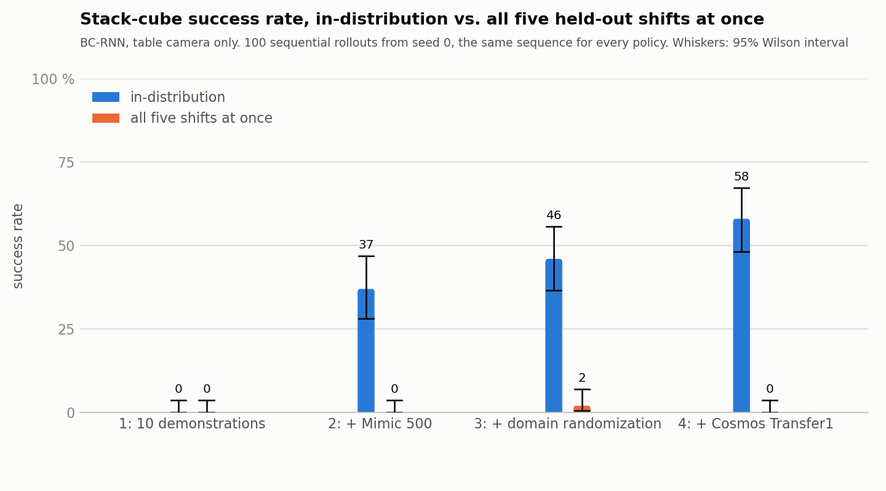
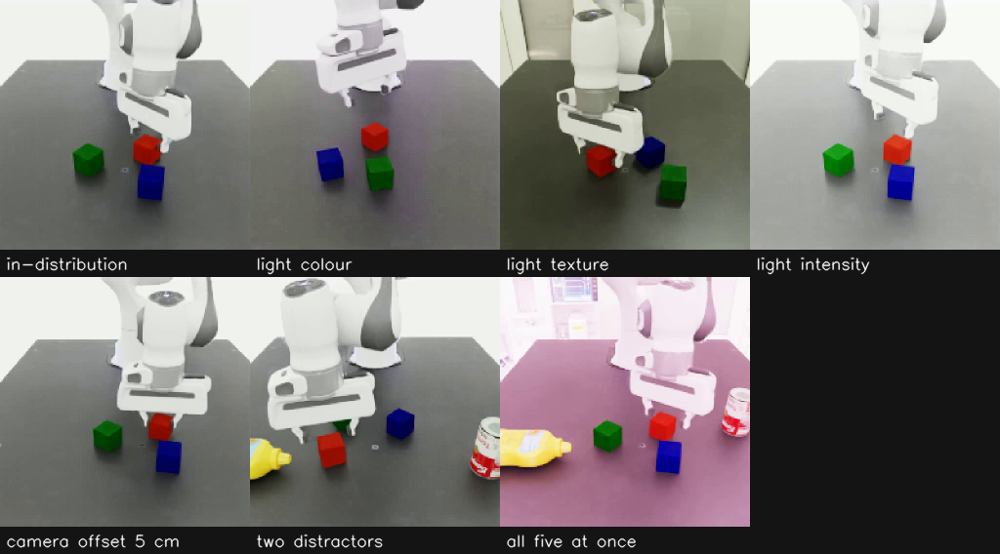

# What breaks a ten-demonstration policy

A Franka arm in Isaac Lab learns to stack three cubes from ten human demonstrations, watching one fixed camera. This
write-up asks which visual changes break that policy, and whether augmenting its training images with NVIDIA Cosmos
Transfer1 helps more than ordinary domain randomization (DR). The short answer: GR00T-Mimic expansion makes the
policy work, and both augmentations make it survive lighting changes, with Cosmos ahead on two of the three lighting
shifts inside the confidence intervals. A moved camera hurts every policy, and extra objects on the table are the
Cosmos policy's blind spot. Everything ran on one machine, a GeForce RTX 5090 with 32 GB, Isaac Sim 6.0.1, Isaac Lab
v3.0.0-beta2.patch1 and Cosmos Transfer1 at the commit Isaac Lab's guide pins.

The evaluation numbers come from `../results/eval_results.md` and the Cosmos gate numbers from the records named
beside them. Install and run-time figures are measurements made on the machine named above. Every step is
reproducible from [`tutorial.md`](tutorial.md).

## 1. Results

Each entry is 100 sequential rollouts of one behaviour-cloning (BC) policy in one condition from seed 0, the same
rollout sequence for every policy. The conditions are the training scene (labelled in-distribution in the figures),
five shifts alone, and all five at once. Policy 1 was evaluated in the training scene and the combined condition
only, 23 evaluations in all.

| Condition | 1: 10 demonstrations | 2: + Mimic 500 | 3: + DR | 4: + Cosmos Transfer1 |
|---|---|---|---|---|
| training scene | 0 | 37 | 46 | 58 |
| light colour | - | 5 | 33 | 49 |
| light texture | - | 0 | 35 | 32 |
| light intensity | - | 0 | 16 | 26 |
| camera offset 5 cm | - | 20 | 9 | 28 |
| two distractor objects | - | 0 | 19 | 4 |
| all five at once | 0 | 0 | 2 | 0 |

A Wilson 95 % interval on 100 rollouts is about plus or minus 9 points mid-range and 0 to 3.7 at zero. The chart
draws the intervals and `../results/eval_results.md` lists them.

**Mimic expansion makes the policy work. It does not make it robust.** Policy 2 goes from 0 to 37 of 100 in the
training scene, then falls to 0 to 5 under any lighting change or two extra objects.

**Lighting is where Mimic alone dies, and where both augmentations help.** Policy 3 recovers 16 to 35 on the three
lighting shifts and policy 4 recovers 26 to 49. Both saw varied lighting in training, the control through the HDR
and intensity randomization and Cosmos through its prompts. Cosmos is ahead on colour and intensity, and texture is
a toss-up (35 to 32 here, 28 to 30 on the rerun), all three inside the intervals. The colour change costs the
Cosmos policy only 9 points from its
training-scene rate.

**Camera offset hurts every policy** (9 to 28). Neither augmentation moves the camera, and a 5 cm shift moves every
pixel the policy keys on. The Cosmos policy's 28 is inside the other two's intervals, and policies 2 and 3 swap
places on the rerun, so no specific robustness is claimed.

**Distractors are the one shift where the control beats Cosmos.** Two unseen objects drop policy 4 from 58 to 4 while
policy 3 keeps 19, and the rerun gives 2 against 25. In the failed clip episodes the Cosmos policy reaches for the
mustard bottle. Cosmos prompts
restyle surfaces and lighting but never add objects, and the edge control pins the scene geometry to the source, so
policy 4 never saw a cluttered table. DR did not add objects either, so why it keeps 19 is open, and 19 against 4 is
a single-seed result, reproduced once.

**All five at once floors everyone** (0 to 2). Changes each policy half survives compound. It is the headline
condition and the honest bottom line: on this task and budget, neither augmentation produces a policy that survives
everything changing at once. It is also the least informative row. When a combined stress test floors every method,
decompose it. The single-shift rows above are where the methods differ.

**In the training scene.** DR adds 9 points over Mimic alone, with overlapping intervals. Cosmos adds 21 points
here and 15 on the rerun, with the intervals barely separating or overlapping. One confound: policy 4
trains on 699 episodes, the 500 Mimic episodes plus 199 Cosmos copies of the same motions, while policies 2 and 3
train on 500. Part of the gain may come from the second rendering of 199 episodes rather than the Cosmos look. The
DR set, which also re-renders the same motions but replaces rather than adds, is the closest control.

**Policy 1.** Ten demonstrations give 0 of 100 in both conditions. The network fits its own data (section 4,
training), so this is compounding error from too few demonstrations, the expected floor.

## 2. Setup

- **Task.** Isaac Lab's Franka three-cube stacking, `Isaac-Stack-Cube-Franka-IK-Rel-Visuomotor-Cosmos-v0`. Success
  means all three cubes stacked within 800 steps.
- **Policy.** robomimic BC-RNN with a ResNet-18 encoder trained from scratch. It observes one fixed 200x200 table
  camera plus end-effector pose and gripper width, and no object poses. 600 epochs x 500 gradient steps per policy,
  Isaac Lab's shipped default, seed 101, the same config for all four. Policy 1's checkpoint is chosen by a
  training-loss plateau rule (section 4, training). The others use epoch 600.
- **Data.** NVIDIA's ten published demonstrations. 500 GR00T-Mimic episodes generated from them and filtered to those
  whose final frame still passes the stack check. The same 500 replayed under Isaac Lab's dome-light randomization
  with the training half of a split of the stock HDR list and intensity range: 455 re-rendered, 45 kept as their
  source render because the replay failed (91 % coverage). 200 of the 500 passed through Cosmos Transfer1 7B
  edge-control distilled, 199 surviving the alignment gate.
- **Protocol.** 100 rollouts per policy per condition from one seed, the same rollout sequence for every policy,
  success rate with a 95 % Wilson interval. A held-out shift set that appears in no training set or Cosmos prompt:
  the other half of the lighting split (dome-light HDRs, intensity 5,000 to 10,000 against 1,500 to 5,000 in
  training), a camera offset of (3, -4, 2) cm, and two YCB distractor objects, a tomato-soup can and a mustard
  bottle. Light colour is the exception: the stock randomizer has one range, so for policy 3 that condition is
  in-distribution and for policies 2 and 4 it is a shift. The prompt generator filters the held-out asset names out
  of NVIDIA's templates. The Cosmos alignment gate scores 20 random frames per episode against the segmentation
  silhouette and drops an episode below 0.6 edge agreement.
- **Hardware and cost.** The one machine named above, with 32 cores and 93 GB RAM. The cost of every stage is in
  [`tutorial.md`](tutorial.md), section 0.4. Data generation, training and the four training-scene evaluations took
  about 32 hours of wall-clock with two or three jobs sharing the GPU. The single-shift table added 14 hours and the
  combined condition 3.7.

## 3. Cosmos Transfer1 on a 32 GB card

#### Model choice

Transfer 2.5 2B needs 65.4 GB by its model card, and multi-control Transfer1 7B about 38 GB even fully offloaded
(NVIDIA's cosmos-transfer1 repository, issue 4). The only published configuration under 32 GB is Transfer1 7B
edge-control distilled with the three offload flags. Issues 192 and 205 report 27 to 30 GB, and 27.1 GB was measured
here. Consequence: one control map instead of Isaac Lab's four, and no colour channel.

#### Install on Blackwell

Blackwell is not officially supported. The install script applies four fixes, all in
`../scripts/setup/install_cosmos_transfer1.sh` and in the tutorial as T16 to T19: a CUDA 12.8 toolchain, the
unrelated PyPI `apex` dropped, a loader-path hook for cuDNN 9, and a `transformers` pin restored. The package
versions that work are in `../scripts/setup/cosmos-transfer1.freeze.txt`.

#### Clip format and memory

1280x704 runs out of memory on 32 GB. Transfer1 snaps inputs to five presets, so clips are exported at 960x704:
26.8 GB for one clip and 27.1 GB over the batch. The tokenizer wants a multiple of 121
frames and colours drift after about 100. Each episode is therefore cut into 121-frame segments every 90 frames and
stitched back, skipping each later segment's copied first frame. Batch mode's validation reads a global input path
that rows do not set, and a placeholder satisfies it (T21).

#### Edge control has to be supplied

Transfer1's internal Canny on 200x200 frames loses the gripper and a cube. The edge control is computed from the
clean RGB plus the segmentation-label boundaries and passed per row, which pins the geometry of gripper and cubes
(T22).

#### The distilled model has no colour channel

`--sigma_max` has no effect on the distilled model, so only the prompt, the first frame and the edge control anchor
the output. Once two cubes touch, the stacked cube takes a neighbour's colour for 10 to 40 % of its frames, in
191 of 200 episodes. The silhouette gate passes 199 of 200 (`../results/figures/cosmos_alignment/alignment_report.json`),
the hue gate 9 of 200. Dropping the hue failures would leave nine episodes. Instead, the write-back replaces each
cube's hue and saturation with the simulator's inside its mask, in every frame of every kept episode, keeping
Cosmos's shading there and everything outside the cubes. Before that correction 32 % of frames exceeded the 40-degree
tolerance, and 196 of the 199 kept episodes did so somewhere. The gate's 191 of 200 counts 20 sampled frames per
episode. Maximum drift was 180 degrees before and 28 after (`../results/records/cosmos_writeback_v2.json`).

#### The output follows the source only at its first frame

Judged on first frames, the outputs keep the source tone: median table brightness 97 in the outputs against 103 in the
sources, in grey levels of the table region. The first frame is the conditioning frame, which Transfer1 copies.
Measured on every frame, 40 % are more than 30 grey levels darker than the source and none lighter. Within a segment
the mean difference falls from 0 to -30 by frame 120 (`../results/figures/cosmos_drift_profile.png`, produced by
`../scripts/cosmos/cosmos_drift_profile.py`). Policy 4 trained on a darker, more varied table than the first frames
suggest, which is consistent with its lighting robustness.

#### Every row reloads the text encoder under offload

With offload, T5-11B and Llama Guard reload for every prompt, most of a row's time.
`../patches/cosmos_transfer1_prompt_cache.patch` memoises the text embeddings and the guardrail verdict per prompt,
and the segments of one episode share a prompt. The full 597-row batch then averages about 46 s per row.

#### The guardrail blocklist contains "Chevron"

Cosmos-Guardrail1's blocklist of 382 brand names includes the company, and Isaac Lab's own template line "chevron-
style black stripes" trips it. The batch logs a guardrail block, skips the row and exits 0. 50 of 200 prompts draw
that line from the stock templates, a quarter of the segments. The prompt generator substitutes "V-shaped" before the
draw, leaving the other 150 prompts identical (T20).

## 4. Notes before you start

Rules that avoid the traps of this pipeline, each with its reason. The troubleshooting table in
[`tutorial.md`](tutorial.md), section 7, has the symptoms.

### Install

#### Pair Isaac Sim 6.0.1 with Isaac Lab tag v3.0.0-beta2.patch1

The `v3.0.0` release needs Isaac Sim 6.2 and a newer driver. The PyTorch wheel the installer pulls has `sm_120`, so
the 5090 needs no custom build. The Franka asset moved on NVIDIA's server after the tag, so the asset-path patch is
always needed (T4).

#### Check the log, not the exit code

Isaac Sim's `python.sh` wrapper can return 0 after a traceback (T5). `../scripts/run_with_vram.sh` greps the log for
`Traceback` and records the VRAM peak.

#### Unset CONDA_PREFIX before any Isaac Lab command

`isaaclab.sh` prefers a conda Python when the variable is set, and an auto-activated base sets it in every new shell
(T3).

#### Accept the Hugging Face licences before the Cosmos download

Four of the five checkpoint repositories are gated (tutorial 2.5).

### Rendering

#### Apply the render patch and run the render check before generating data

The stock Cosmos environment config turns antialiasing off, which on Isaac Sim 6.0.1 leaves the path tracer
undenoised. `../patches/isaaclab_cosmos_env_dlaa.patch` restores DLAA and three re-renders on reset. A clean render
scores 4 to 9 in the check of tutorial 2.4, speckle scores 81 to 114.

#### Look at a contact sheet of every training set before training on it

`../scripts/diag/first_frames.py` makes one. Compare it with `../results/figures/data_samples/`.

#### Keep the stock material randomizers off

A runtime material bind on the table or robot visuals with Fabric on makes the renderer re-sync those prims with
stale transforms, and Fabric off freezes the render (T10). `../cosmos_demo/textures.py` randomizes the dome light
only. If a render looks wrong, check the depth channel: it shows whether the geometry moved.

### Datasets and replay

#### Filter Mimic episodes on their final frame

Mimic marks an episode successful at the first frame the stack check passes, and about 6 of 100 topple during the
retreat. `../scripts/data/filter_mimic.py` applies the same check to the last frame.

#### Fill replay drop-outs from the source instead of rerunning them

Replay with one environment breaks about 9 % of the stacks generated with ten, because PhysX contact results differ
(T9). `../scripts/data/merge_dr.py --fill` copies the source render for those episodes and records which.

#### Copy the root attributes of every derived HDF5

Isaac Lab 3.0 datasets carry `format_version = 1` at the root, meaning quaternions are XYZW, and h5py group copies do
not carry root attributes. Without it the robot base replays rotated 180 degrees and every replay fails from step 0
(T11). Copy `f.attrs` in every derived file.

#### Replay one known-good episode of every derived file before a long job

`../scripts/diag/diag_replay.py` shows whether a failure starts at step 0 or grows with time. Tutorial 3.2 runs it on
the Mimic set.

#### Import project task modules after the app launches

Importing `isaaclab_mimic` before `AppLauncher` kills the app silently (T12). Isaac Lab's `--external_callback` and
the project scripts import after launch.

### Training and evaluation

#### Train the full 600 epochs

On the ten-demonstration set the training loss keeps falling to epoch 600, and shorter budgets leave every policy
near zero.

#### Read the offline check as a load test only

`../scripts/diag/check_policy_offline.py` takes a minute and shows that a checkpoint loads and fits its data. It never
leaves the recorded states and cannot see the compounding error that decides a rollout.

#### Select policy 1's checkpoint with the plateau clause alone

`../scripts/train/early_stop_p1.py replay --flat-only` tracks a 10-epoch running median of the training loss and takes
the checkpoint nearest the best median once it has not improved for 30 epochs. A median, not a mean: one outlier epoch
lifts a mean for ten epochs. The rule's rising clause trips on the early plateau of a ten-demonstration loss curve, so
it is left out. On the shipped series `../results/records/p1_v2_600_loss.txt` the rule stops at epoch 187 and selects
checkpoint 160.

#### Never run Isaac Sim and Cosmos together, and at most three Isaac Sim processes

Trainings take 4.5 GB, evaluators 9 to 10 GB after a few minutes, the Cosmos batch 27 GB. A fourth evaluator beside a
training runs out of memory (T15). Three trainings at once give 1.7x the solo throughput. Tutorial 0.4 has the plan.

#### Do not stop an Isaac Sim process with SIGSTOP

A stopped process is killed by its supervisor and the job is lost. To free the GPU, wait for a job to finish or kill
it.

#### Export the checkpoint variables, and read the terminal after launching a queue

The queue files name `$CKPT_P1` to `$CKPT_P4`, which the queue script expands from the environment, and the clip driver
reads the same variables plus `P1_EPOCH` in a child process. Set them with `export`. A row whose checkpoint is not
found is skipped with a `SKIP` line on the terminal and in `results/eval_queue.log`, so read it before leaving a queue
to run.

#### Give the early-stop replay the run directory that holds models/

`early_stop_p1.py replay` picks the saved checkpoint nearest the best epoch from that folder. Without it the decision
line says `chosen_checkpoint=None`.

#### Run one Cosmos batch at a time over an output directory

The resume mode renumbers folders, so a second batch or a resume over the same `out200_v2` corrupts the sequence the
stitch step reads.

#### Keep the labels and file names exactly

The chart and the clips page parse evaluation labels and file names (tutorial 5.1).

#### Count outputs, not exit codes

A guardrail block skips a Cosmos row and still exits 0 (T20). Compare the number of output folders with the number of
rows after every batch.

#### Look at the shift-frame sheet before trusting a shift row

`../results/figures/shift_frames_<label>.png` shows the first frames the policy saw under that shift.

#### Measure augmented data on all frames

Cosmos outputs match the source on the first frame and drift afterwards (section 3). Check any property of augmented
data on all frames, with the same statistic as the shift you test. Tutorial 3.4, step 8, plots the drift.

#### Use the fixed seeds

Tutorial 0.5 lists them. Changing one changes every number.

## 5. Limitations

- One training seed per policy and 100 rollouts per condition: differences inside the intervals are not claims. The
  three lighting comparisons between policies 3 and 4 are inside the intervals.
- Policy 4 sees 199 more episodes than policies 2 and 3 (section 1, training scene).
- The Cosmos cube-colour correction is a post-processing step, not part of NVIDIA's pipeline. It rewrites the cube
  pixels' hue and saturation in every frame of the Cosmos set (section 3).
- The alignment gate's threshold of 0.6 is the script's default. Silhouette minima range from 0.57 to 0.97, so the
  gate removed one episode.
- Edge control only. NVIDIA's guide uses four control maps on a larger GPU, and its reported gains may depend on that.
- The shift set covers lighting, camera pose and scene content. The appearance of the table, robot and cubes is not
  varied, so the results say nothing about that kind of change.
- Light colour is drawn from the same range in training and evaluation, because the stock randomizer has one range.
  For policy 3 that condition is in-distribution. The other four shifts are disjoint.
- 45 of policy 3's 500 episodes keep their source render, so its lighting variation covers 91 % of the set.
- The first observation of every episode, in training sets and evaluations alike, is the render from before the reset
  (section 4, rendering). It is the same for every policy and condition, but every policy trained and acted on one stale frame
  per episode.
- Evaluations ran two or three at a time on one GPU. PhysX contact results can vary with load, so a repeated
  evaluation does not reproduce a row exactly. A rerun of all 23 from a clean clone with the same checkpoints and
  seed is in `../results/records/eval_results_rerun.md`. It reproduced 21 rows within 7 points and moved the
  camera-offset rows of policies 2 and 3 by 11 and 13. A difference between two rows of that size is not evidence on
  its own.
- Policy 1 is 0 of 100 in every condition, so the floor carries no information about the shift.

## 6. Next

- A Cosmos prompt set that adds clutter. The distractor result says object-level variation, not surface variation, is
  what is missing. Since the edge control pins geometry, the objects would be placed in the simulator (training-only
  YCB objects, not the held-out two) and Cosmos would restyle the frames that contain them. About a GPU day.
- A second training seed for policies 3 and 4. Their single-shift differences are inside the intervals.
- A local assistant over this playbook (NIM), so the troubleshooting table can be queried with a pasted error log.
